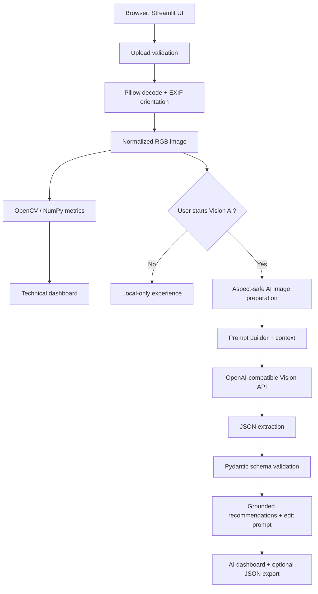

# Laqta AI

**AI-Powered YouTube Thumbnail Analyzer & Creative Assistant**  
*Analyze. Improve. Create.*

Laqta AI is a local-first Streamlit application for YouTube thumbnail review. It combines reproducible computer-vision measurements with an optional multimodal Vision AI review. Without an API key, upload validation, image preview, image metadata, color extraction, luminance, contrast, saturation, sharpness indicators, and clipping checks remain available.

> **Important distinction:** Computer-vision values are calculated from pixels. Visual-analysis scores and creative recommendations are subjective model judgments. Neither is an objective measure of thumbnail quality or a prediction of YouTube click-through rate (CTR).

## Features

- JPG, JPEG, PNG, and WEBP upload with extension/content verification, file-size limits, pixel-count limits, EXIF orientation handling, and RGB normalization.
- High-quality original preview with no aspect-ratio distortion.
- OpenCV / NumPy measurements: brightness (Rec. 709 luma), contrast (luma standard deviation), average HSV saturation, Laplacian variance, near-black / near-white pixel percentages, and k-means dominant colors.
- Optional image-aware analysis of visual hierarchy, subject visibility, composition, color harmony, text readability, background clutter, visual focus, and relevance to the supplied video title.
- Strict Pydantic response validation. Invalid, incomplete, or malformed model responses are rejected rather than displayed as analysis.
- Three grounded strengths, three improvement opportunities, prioritized actions, and a prompt for an image-editing tool.
- Arabic or English recommendation language, video title, category, and desired visual style context.
- JSON report export after a valid AI response.
- No permanent upload storage. The image is handled in Streamlit session memory; it is sent to the configured Vision provider only when the user explicitly runs AI analysis.

## Quick start

### 1. Requirements

- Python 3.11 or newer
- Git (optional, for version control)
- A multimodal model provider with an **OpenAI-compatible Chat Completions API** for AI review. Local CV features do not require this.

### 2. Create an environment and install

```bash
git clone <your-repository-url>
cd laqta-ai
python -m venv .venv

# Windows PowerShell
.venv\Scripts\Activate.ps1

# macOS / Linux
source .venv/bin/activate

python -m pip install --upgrade pip
pip install -r requirements-dev.txt
```

### 3. Configure Vision AI (optional)

Copy `.env.example` to `.env`, then set your key and model. Do not commit `.env`.

```dotenv
LAQTA_VISION_API_KEY=your_real_key
LAQTA_VISION_BASE_URL=https://api.openai.com/v1
LAQTA_VISION_MODEL=gpt-4.1-mini
LAQTA_VISION_TIMEOUT_SECONDS=90
```

Laqta AI reads environment variables. Streamlit deployments can also use `.streamlit/secrets.toml` (keep that file out of Git):

```toml
LAQTA_VISION_API_KEY = "your_real_key"
LAQTA_VISION_BASE_URL = "https://api.openai.com/v1"
LAQTA_VISION_MODEL = "gpt-4.1-mini"
LAQTA_VISION_TIMEOUT_SECONDS = "90"
```

The configured model must accept image input and support JSON mode (or compatible `response_format: {"type":"json_object"}`). The client sends a base64 JPEG data URL and structured context to `POST {LAQTA_VISION_BASE_URL}/chat/completions`. Compatible providers may use a different base URL and model. If the provider does not support image input or JSON mode, configure a compatible model/provider. Provider API usage may incur costs.

Optional safeguards:

```dotenv
LAQTA_MAX_UPLOAD_MB=12
LAQTA_MAX_IMAGE_PIXELS=40000000
LAQTA_MAX_AI_IMAGE_SIDE=1600
```

### 4. Run the application

```bash
streamlit run app.py
```

Streamlit prints a local URL (usually `http://localhost:8501`).

### 5. Run tests

```bash
pytest -q
```

## System architecture



## Project structure

```text
laqta-ai/
├── app.py                       # Streamlit UI and interaction flow
├── laqta_ai/
│   ├── __init__.py
│   ├── analysis_service.py      # Local + optional AI orchestration
│   ├── config.py                # Environment / Streamlit secrets
│   ├── image_analyzer.py        # Upload validation and image preparation
│   ├── metrics.py               # Actual OpenCV / NumPy measurements
│   ├── prompts.py                # Grounded multimodal prompt
│   ├── recommendations.py       # Score and priority presentation helpers
│   ├── schemas.py                # Strict Pydantic response models
│   └── vision_client.py         # OpenAI-compatible Vision API client
├── tests/
│   ├── test_image_analyzer.py
│   ├── test_metrics.py
│   └── test_schemas_and_prompts.py
├── .env.example
├── .gitignore
├── .streamlit/
│   └── config.toml
├── requirements.txt
├── requirements-dev.txt
└── README.md
```

## Processing pipeline

1. **Upload:** Streamlit receives the file in memory. The application checks the extension, actual decoded format, byte size, and image pixel count before full processing.
2. **Decode:** Pillow verifies and decodes the image, applies EXIF orientation, and converts it to RGB. The original proportions remain intact.
3. **Local CV:** OpenCV computes grayscale/luma-related, HSV saturation, Laplacian, and color-clustering signals. NumPy calculates summary statistics and pixel percentages.
4. **AI preparation:** Only after the user clicks **Analyze with Vision AI**, an aspect-safe copy is resized to the configured maximum side and JPEG-encoded. The upload is not written to a project folder.
5. **Multimodal review:** The client sends the image and the video title/category/style to the configured provider. The system prompt requires visible evidence, explicit uncertainty, and an exact structured response.
6. **Validation:** JSON is parsed and checked against Pydantic models (including score bounds and exactly three strengths / opportunities). Failed validation produces an error and no AI report.
7. **Presentation:** Technical metrics and model judgments are shown in separate sections. Users can export a JSON report after successful AI analysis.

## How OpenCV is used

- `cv2.cvtColor`: RGB-to-BGR, BGR-to-gray, BGR-to-HSV conversion.
- `cv2.Laplacian`: Laplacian variance as a relative edge/detail indicator.
- `cv2.kmeans`: dominant-color clustering on a small, downsampled pixel sample.
- `cv2.resize`: controlled downsampling for color analysis.
- NumPy: Rec. 709 luma, average/standard-deviation calculations, clipping percentages, and color cluster percentages.

Definitions:

- **Brightness:** Mean Rec. 709 luma calculated from normalized, gamma-encoded sRGB channel values, shown on a 0–100 scale.
- **Contrast:** Standard deviation of that luma signal, shown on a 0–100 scale. It describes global tonal spread, not local contrast.
- **Saturation:** Mean HSV saturation, shown on a 0–100 scale.
- **Sharpness variance:** Variance of the grayscale Laplacian. It is content- and resolution-dependent; it is not a universal grade.
- **Near-black / near-white:** Share of pixels with calculated luma below 0.05 / above 0.95.
- **Dominant colors:** Up to five k-means cluster centers and their approximate pixel shares.

## How the AI integration works

`VisionClient` uses standard HTTP requests rather than locking the code to one vendor SDK. It constructs a multimodal Chat Completions request with a base64 JPEG data URL, a system prompt, and user-supplied context. The response must contain one JSON object that conforms to `ThumbnailAnalysis`.

AI scores from 1–10 are editorial heuristics. The displayed average is an experimental navigation aid only. There is no training on user data by this application, and no CTR model is implemented. Your configured provider receives the image and context when AI analysis is explicitly requested; check that provider's data and retention terms before using sensitive content.

## Configuration reference

| Variable | Default | Purpose |
|---|---|---|
| `LAQTA_VISION_API_KEY` | unset | Provider credential; required to enable remote AI in this app |
| `LAQTA_VISION_BASE_URL` | `https://api.openai.com/v1` | OpenAI-compatible API base URL |
| `LAQTA_VISION_MODEL` | `gpt-4.1-mini` | Image-capable model identifier |
| `LAQTA_VISION_TIMEOUT_SECONDS` | `90` | HTTP request timeout |
| `LAQTA_MAX_UPLOAD_MB` | `12` | Maximum upload bytes in MiB |
| `LAQTA_MAX_IMAGE_PIXELS` | `40000000` | Maximum decoded pixel count |
| `LAQTA_MAX_AI_IMAGE_SIDE` | `1600` | Longest side of the aspect-safe AI copy |

## Security and privacy notes

- No API key is hardcoded or displayed in the UI.
- `.env` and Streamlit secrets are ignored by Git.
- Uploads are not permanently saved by this application. The active Streamlit session keeps the image in memory while the session is active.
- Remote AI analysis is opt-in per run. The configured provider receives the image and analysis context.
- Upload size, extension/content match, image format, and pixel count are checked.
- Model output is untrusted and schema-validated. Provider error messages are length-limited before display.
- For production deployment, add authentication, rate limiting, request quotas, TLS termination, deployment-level session controls, and a documented data-retention policy.

## Known limitations

- Computer vision measures image properties; it cannot determine whether a thumbnail tells a compelling story or predicts CTR.
- Brightness / contrast metrics are global. Local contrast, saliency, OCR confidence, face detection, and subject segmentation are not currently implemented.
- Dominant colors are approximate k-means clusters and can vary slightly with image content and OpenCV versions.
- Sharpness variance is sensitive to resolution, texture, and noise.
- Vision analysis quality depends on the configured model, image support, language capability, and provider implementation. A malformed response is rejected.
- The client currently targets the OpenAI-compatible Chat Completions shape. Providers requiring a different API protocol need a small adapter in `vision_client.py`.
- The app uses Streamlit's session lifecycle; production deployments should configure suitable resource limits and session security.

## Git and GitHub

```bash
git init
git add .
git commit -m "Build Laqta AI thumbnail analyzer"
git branch -M main
git remote add origin https://github.com/<username>/laqta-ai.git
git push -u origin main
```

Before pushing, verify that `.env`, `.streamlit/secrets.toml`, and any generated private images are not staged.
